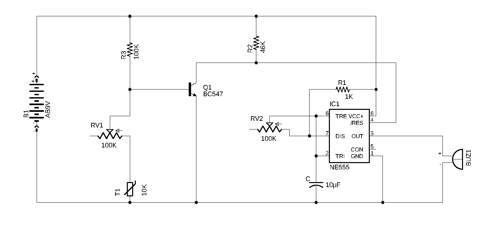

## 🔥 Fire Alarm using Thermistor and 555 Timer

This project demonstrates a heat-activated alarm using an **NTC thermistor** and the **NE555 timer IC**. When the temperature near the sensor rises, the buzzer starts beeping. Designed as a beginner-friendly electronics project, this helped enhance my hands-on skills in analog circuits, sensor interfacing, and timer-based design.

---

## 🔧 Tools & Technologies Used

- **NE555 Timer IC** – Makes the beeping signal
- **NTC Thermistor (10K)** – Senses heat (resistance drops as temperature rises)
- **BC547 Transistor** – Switches the 555 timer on and off based on temperature
- **Potentiometers (RV1 10K, RV2 100K)** – RV1 sets the trigger temperature, RV2 sets the beep speed
- **Active Buzzer** – Makes the alarm sound
- **9V Battery** – Powers the circuit
- **Autodesk EAGLE** – Used to design the schematic and the PCB layout
- **Resistors, capacitors, switch, wires** – Supporting parts

---

## 🧾 Parts List

| Part | Value | Use |
|------|-------|-----|
| B1 | 9V battery | Power |
| S1 | Switch | On/off |
| IC1 | NE555 | Oscillator |
| Q1 | BC547 | Switch |
| T1 | 10K NTC thermistor | Heat sensor |
| RV1 | 100K pot | Trigger temperature |
| RV2 | 100K pot | Beep speed |
| R1 | 1K | 555 timing |
| R2 | 46K | Pulls reset pin high |
| R3 | 100K | Base bias for Q1 |
| C | 10µF | 555 timing |
| BUZ1 | Active buzzer | Sound |

---

## 📝 Project Description

- Developed a heat alarm using a thermistor, a transistor and a 555 timer.
- The **thermistor** and **RV1** form a voltage divider that controls the **BC547** transistor.
- The **BC547** controls the reset pin (pin 4) of the **555 timer**.
- The **555** is wired as an oscillator, so the **buzzer** beeps when the alarm is active.
- This project helped me understand basic **sensor interfacing**, **transistor switching** and **555 timer oscillator** design.

---

## 🔌 How It Works

1. When it is cool, the thermistor's resistance is high, so Q1 is **ON** and pulls pin 4 low. The 555 is disabled and the buzzer is silent.
2. When it gets hot, the thermistor's resistance drops, so Q1 turns **OFF**.
3. R3 pulls pin 4 high, the 555 starts, and the buzzer beeps.
4. RV2 changes the beep speed. RV1 changes the temperature at which the alarm starts.

### Setting the trigger temperature

1. Set the desired alarm temperature to **60°C**.
2. For a 10 kΩ NTC thermistor (B = 3950 K), the resistance at 60°C is approximately **2.49 kΩ**.
3. The circuit switching threshold is approximately **8 kΩ**.
4. Set the RV1 potentiometer to approximately **5.5 kΩ** (8 − 2.49 = 5.51 kΩ).
5. Fine-tune RV1 by heating the thermistor and checking the buzzer activation temperature.

---

## 🧠 Learning Outcomes

- Working of NTC thermistors and voltage dividers
- Using a transistor as a switch
- Using the 555 timer as an oscillator
- Power consumption and battery life problems
- Troubleshooting real-world hardware issues

---

## ⚠️ Known Limitations

- It only senses heat close to the sensor. A smoke detector reacts much earlier.
- If the thermistor wire breaks, the alarm stays silent.
- A dead battery gives no warning.
- There is no hysteresis, so the alarm may stutter at the exact trigger temperature.

---

## 🛠️ Design and Implementation

- Designed the circuit schematic and PCB layout using **Autodesk EAGLE**.
- Built and tested the circuit on a breadboard using an NE555 timer, BC547 transistor, NTC thermistor, and buzzer.
- Fabricated the PCB and soldered the components to assemble the final circuit.
- Powered the circuit using a 9V battery.
- Tested the circuit under normal and elevated temperature conditions to verify automatic buzzer activation.
  
---

## 📷 Media

### 🔌 Circuit Diagram:

### 🎥 Demo Video:
👉 [Watch Demo](https://drive.google.com/drive/folders/1Pbn1WBMJVAjlfn9Htr2KEi_Wj8BANrUW?usp=sharing)

---

## 📁 Files

- [Fire_Alarm.sch](Fire_Alarm.sch) – EAGLE schematic
- [Fire_Alarm.brd](Fire_Alarm.brd) – EAGLE board layout

---

## 🔗 Future Improvements

- Make a version 2 of the PCB with the corrected values and the extra parts (series resistor for RV2, bypass capacitors, power switch)
- Make the alarm sound when the thermistor wire breaks (fail-safe)
- Add a low-battery warning
- Add hysteresis so the alarm does not stutter
- Add a smoke sensor along with the heat sensor

---

## 👨‍💻 Author

**Himanshu Raj** |
B.Tech EE @ NIT Patna    
[GitHub](https://github.com/himanshurajx) | [LinkedIn](https://linkedin.com/in/himanshurajx)

---
